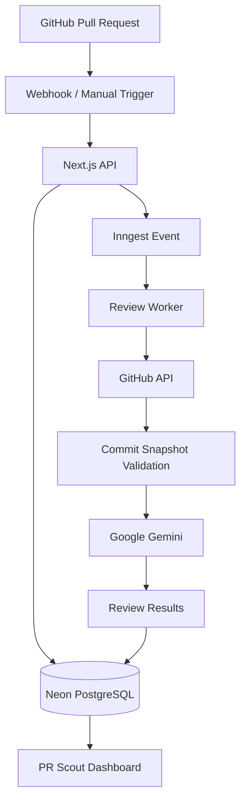

# PR Scout

**Commit-aware AI code reviews for GitHub pull requests.**

PR Scout analyzes pull request changes using Google Gemini, identifies potential code issues, and presents actionable findings with severity levels, file references, and an overall risk score.

Reviews run asynchronously through Inngest, while PostgreSQL-backed delivery tracking and commit-aware review identity keep processing reliable when webhooks are duplicated or pull requests change.

**[Live Application](https://pr-scout.vercel.app) · [GitHub Repository](https://github.com/adnan36609/PR-Scout)**

---

## Overview

PR Scout connects directly to GitHub repositories and provides an AI-assisted code review workflow.

* **Contextual analysis:** Reviews changed files and their available diff context rather than treating a pull request as an isolated text prompt.
* **Actionable findings:** Surfaces potential bugs, security concerns, performance issues, and code-quality improvements with file and line references.
* **Risk assessment:** Provides an overall risk score and severity-ranked findings.
* **Flexible execution:** Supports both manually triggered reviews and automatic reviews initiated by GitHub pull-request events.

## Engineering Highlights

### Commit-aware review processing

Every active review is identified by its repository, pull request number, base commit SHA, and head commit SHA.

Before and after retrieving changed files, the worker checks that the pull request still matches the requested snapshot. This helps prevent reviews from silently being associated with newer commits.

### Reliable webhook handling

GitHub webhook deliveries are persisted in PostgreSQL and tracked through their processing lifecycle.

* Duplicate delivery IDs are rejected.
* Failed or interrupted deliveries can be retried.
* Concurrent requests for the same pull-request snapshot reuse the same active review.
* Active review identities are released when reviews reach terminal states.

### Asynchronous execution

Inngest handles background review execution independently of the incoming webhook request.

The workflow supports retries, cancellation, and persistent review states, while the dashboard provides visibility into review progress and results.

## Architecture



## Technology Stack

| Layer                | Technologies                     |
| -------------------- | -------------------------------- |
| Application          | Next.js 16, React 19, TypeScript |
| UI                   | Tailwind CSS v4, shadcn/ui       |
| API                  | tRPC                             |
| Authentication       | Better Auth, GitHub OAuth        |
| Database             | PostgreSQL, Neon                 |
| ORM                  | Prisma 7                         |
| Background execution | Inngest                          |
| AI analysis          | Google Gemini                    |
| Validation           | Zod                              |
| Testing              | Vitest                           |
| Deployment           | Vercel                           |

## Getting Started

### Prerequisites

* Node.js compatible with Next.js 16
* pnpm
* PostgreSQL database
* GitHub OAuth application
* Google Gemini API key
* Inngest account

### Installation

Clone the repository:

```bash
git clone https://github.com/adnan36609/PR-Scout.git
cd PR-Scout
```

Install dependencies:

```bash
pnpm install
```

### Environment Configuration

Create a `.env` file in the project root:

```env
DATABASE_URL=

BETTER_AUTH_SECRET=
BETTER_AUTH_URL=http://localhost:3000

GITHUB_CLIENT_ID=
GITHUB_CLIENT_SECRET=
GITHUB_WEBHOOK_SECRET=

GEMINI_API_KEY=
GEMINI_MODEL=
GEMINI_FALLBACK_MODEL=

NEXT_PUBLIC_APP_URL=http://localhost:3000

INNGEST_DEV=1
```

`GITHUB_WEBHOOK_SECRET` is required when receiving GitHub webhooks. The Gemini model variables are optional overrides; the application provides defaults.

Never commit `.env` or expose credentials in source control.

### Database Setup

Apply the Prisma migrations:

```bash
pnpm exec prisma migrate dev
```

Generate the Prisma Client:

```bash
pnpm exec prisma generate
```

### GitHub OAuth

Create a GitHub OAuth application and configure its local authorization callback:

```text
http://localhost:3000/api/auth/callback/github
```

Add the generated client ID and secret to `.env`.

### Run Locally

Start the Next.js application:

```bash
pnpm dev
```

In a separate terminal, start the Inngest Dev Server:

```bash
npx --ignore-scripts=false inngest-cli@latest dev -u http://localhost:3000/api/inngest
```

The application runs at:

```text
http://localhost:3000
```

The Inngest development interface is available at:

```text
http://localhost:8288
```

## Testing

Run the complete test suite:

```bash
pnpm test
```

Run TypeScript checks:

```bash
pnpm exec tsc --noEmit
```

Create a production build:

```bash
pnpm build
```

## Production

PR Scout is deployed on Vercel, with Neon providing PostgreSQL storage and Inngest handling background execution.

**[Open PR Scout](https://pr-scout.vercel.app)**

Production webhooks are received at:

```text
https://pr-scout.vercel.app/api/webhooks/github
```

Production Inngest functions are served at:

```text
https://pr-scout.vercel.app/api/inngest
```

Production configuration, database migrations, OAuth setup, and webhook registration should be maintained separately from local development configuration.

---

**PR Scout** · AI-assisted code review for GitHub.
